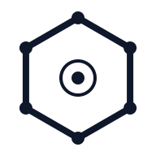

<picture>
  <source media="(prefers-color-scheme: dark)" srcset="assets/consortium-mark-dark.svg">
  
</picture>

# The Computronium Consortium

**A proposal for a community-led effort to make evidence about learning mechanisms easier to inspect, compare, reproduce, and improve.**

> **This is a starting proposal, not a settled charter.** It is an invitation to researchers, practitioners, and other interested participants to help decide what the consortium should become. Its scope, governance, services, and standards should be shaped through participation and revised in light of experience.

## The problem worth solving

Research on learning mechanisms is difficult to compare across papers, implementations, tasks, and labs. A reported result reflects more than the learning rule itself: dataset choices, preprocessing, implementation details, compute, hyperparameter search, stopping criteria, random seeds, metrics, and reporting decisions can all matter.

These differences are not necessarily mistakes or misconduct. Different studies may be answering different questions. The problem arises when the conditions behind a result are difficult to inspect, when unlike results are treated as direct comparisons, or when the cost of careful replication is too high for any one group to bear.

That gap affects the whole field. Authors want their methods to be represented faithfully. Practitioners want to know what a result does and does not establish. Reviewers need enough information to assess the evidence. Researchers building on earlier work need a way to find out which conclusions survived scrutiny and which have changed.

The opportunity is to make research more cumulative: preserve the context of each claim, make comparisons interpretable, share the work of verification, and treat corrections as progress rather than embarrassment.

## Why a consortium?

No single lab can reasonably carry every implementation, benchmark, replication, and audit. Nor should one team decide unilaterally what counts as a meaningful comparison for every research question.

A consortium could bring together people with different methods, expertise, resources, and incentives to build common practices where they are useful. It could coordinate work that is hard to sustain alone, make assumptions and disagreements visible, and create a public record that improves as more people examine it.

The aim is **not** to declare one universally best algorithm, force every experiment into one protocol, or centralize independent research. It is to make claims easier to assess and comparisons more useful when comparison is the goal. A good consortium should make it easier to disagree productively, not require everyone to agree on a ranking.

## The relationship to Computronium

**Computronium is a codebase and experimental framework. The Computronium Consortium is a proposed collaboration. They are related, but they are not the same thing.**

Anyone is free to use, modify, fork, or evaluate methods with Computronium independently of a consortium. Researchers do not need to join, seek permission, or accept a consortium protocol to pursue their own work or report their best results. The consortium may choose to use Computronium, other tools, or a combination of approaches for particular studies.

Using Computronium does not by itself make a result independent, verified, fair, preregistered, or endorsed by the consortium. Those descriptions should depend on what was actually done and reviewed. Likewise, a study conducted outside the consortium may still be valuable and reproducible; it simply should not be presented as having undergone a consortium process that it did not undergo.

The current codebase and documentation provide possible starting materials, not a finished institutional design. The consortium should decide collectively which tools and practices to adopt, change, supplement, or leave aside.

## A provisional mission

**Help the research community produce evidence about learning mechanisms that is easier to inspect, compare where appropriate, reproduce, correct, and build on.**

The following are proposed working principles for discussion, not immutable rules:

- **Transparency.** Describe the method, implementation, task, metric, resources, tuning choices, and limitations well enough for readers to understand what a result means.
- **Pluralism.** Recognize that different scientific questions call for different tasks, metrics, budgets, and evaluation designs. No single benchmark or protocol should be treated as universally decisive.
- **Proportionate rigor.** Make the strength of a claim match the strength of the evidence. Exploratory results, preregistered comparisons, independent replications, and formal certifications—if such certifications are ever offered—should not be conflated.
- **Faithful representation.** Document implementation choices and departures from published methods. Give method authors a reasonable opportunity to identify factual errors without giving them control over the conclusions.
- **Correction as normal practice.** Keep a visible history of material corrections, including corrections to work produced or sponsored by the consortium.
- **Open criticism and shared governance.** Make important process decisions reviewable, provide ways to challenge them, and leave room for reasoned disagreement.
- **Useful negative findings.** Publish informative null or inconclusive findings alongside positive results, with their limitations and uncertainty made clear.

## What the consortium could do first

The first objective should be to establish a credible way of working—not to solve every problem in experimental methodology before beginning. A practical first phase could:

1. **Convene participants and draft a charter.** Agree on the initial purpose, scope, decision-making process, membership expectations, and how conflicts of interest and disagreements should be handled.
2. **Choose one bounded pilot together.** Select a concrete research question that is important enough to matter and narrow enough to complete, given the people and resources available.
3. **Agree on what must be reported for that pilot.** At minimum, consider the claim being tested, implementation provenance and deviations, data and metrics, compute and tuning conditions, randomization, uncertainty, exclusions, and known limitations. The requirements should fit the question rather than pretend to fit every future study.
4. **Invite independent scrutiny.** Ask people who did not lead the work to review the protocol or reproduce a defined part of the result, within the pilot's available resources.
5. **Publish the result and the lessons.** Record what was learned, including inconclusive findings, disagreements, and shortcomings in the process. Revise the protocol before expanding its use.

The pilot should test the consortium's working process as well as the scientific question. A useful first outcome may be a better understanding of what the group can reliably do, what it cannot yet do, and what should be attempted next.

## Potential activities and optional services

Participants may decide to coordinate several kinds of work over time, for example:

- shared study descriptions, reporting templates, and preregistration practices;
- implementation review and independent replication;
- benchmark design and multi-lab evaluation campaigns;
- a public record of results, limitations, disputes, and corrections;
- shared access to datasets, compute, or other infrastructure;
- specialist services that help researchers design or execute particular kinds of evaluations.

These activities need not all be created at once, funded in the same way, or made compulsory for every participant. The consortium should distinguish its common purpose and governance from the optional services it may eventually offer. Each service should state what it does, what it costs, what evidence it provides, and what it does not establish.

### Hyperparameter optimization is a separate service to consider

Hyperparameter optimization (HPO) can substantially affect reported performance, but there is no universally fair tuning procedure that can simply be assumed to work for every method and research question. Different algorithms may have different search spaces, costs, convergence behavior, and meaningful notions of training effort.

For that reason, **a standardized HPO service should not be a core promise of the consortium at its outset**. Participants can decide whether it is needed, who has the expertise to design it, and how its claims should be reviewed. If developed, it should be described as a distinct service with its own protocol and limitations—not as a guarantee that every consortium comparison is fair.

An HPO service should disclose, as appropriate, the search space, search strategy, stopping rules, treatment of failed trials, hardware and resource accounting, and the definition of the budget being matched. Depending on the question, useful comparisons might involve equal elapsed time, accelerator-hours, training steps, trial counts, or a different declared budget. These choices answer different questions; none should be called neutral merely because it is standardized.

Researchers should remain free to tune methods for their own best achievable results. A study seeking best performance under a stated workflow and a study seeking comparison under a shared budget are both legitimate, but they should describe their aims and conditions clearly. Over time, the consortium may support more than one evaluation profile rather than force every question into a single definition of fairness.

## What exists today—and what it does not establish

The existing Computronium project contains work that may be useful to this effort, including algorithm identity cards, preregistration tooling, a corrections log, and documentation exploring HPO. These are starting points for discussion and experimentation.

Their existence does **not** mean that a consortium has adopted them as policy, that every procedure is automatically enforced by the software, or that results produced with the current codebase have been independently verified. Current limitations described in the project documentation should remain visible, and any future public claim should be limited to what a particular study and review process actually support.

Relevant background in the current repository includes the [project README](../README.md), [Algorithm Identity Cards](IDENTITY_CARDS.md), [Corrections log](CORRECTIONS.md), [preregistration tooling](../computronium/validation/preregistration.py), and [HPO protocol](hpo_protocol.md). These documents describe aspects of the codebase; they do not predetermine what the consortium must become.

## Decisions participants should shape

The founding group should decide, rather than assume in advance:

- **Scope:** Which kinds of learning mechanisms, claims, tasks, and research communities should be in scope first?
- **Governance:** Who can propose or change standards? How are decisions made, and how can decisions be appealed or revisited?
- **Participation:** What contributions are useful, what commitments are reasonable, and how can people participate without endorsing every view or result?
- **Evidence and review:** What information is required for different kinds of claims, and how should implementation disputes, failed replications, and corrections be handled?
- **Services:** Which activities belong in a shared core process, and which should remain optional specialist services, such as HPO or implementation audits?
- **Resources:** How should costs, infrastructure, funding, credit, and maintenance responsibilities be handled without excluding participants who have limited resources?
- **Expansion:** What should a successful pilot demonstrate before the consortium widens its scope or makes stronger claims?

The answers can evolve. The important thing is to make the decision process explicit and to avoid turning today's assumptions into permanent rules by accident.

## A path for iterative growth

A sensible path is staged and revisable:

1. **Form the working group.** Gather interested participants and turn this proposal into a first charter.
2. **Run a bounded pilot.** Agree on one question, the reporting requirements, the available resources, and an appropriate review process.
3. **Audit the process, not just the result.** Ask what was useful, what was ambiguous, what proved too expensive, who was missing, and which conclusions were warranted.
4. **Revise in public.** Publish the protocol changes and reasons for them, preserve a record of superseded claims, and invite further criticism.
5. **Expand selectively.** Add methods, tasks, working groups, or optional services only when participants and resources are ready to support them.

This is not a plan to reach a final, perfect protocol once and for all. Scientific methods, available resources, and participant needs will change. The goal is a durable practice of making careful commitments, learning from their limits, and improving them without hiding the history.

## The invitation

Bring an algorithm, a research question, a benchmark concern, a critique, expertise in methodology or statistics, implementation work, data, compute, funding, or simply time to help shape the first steps. A strong objection to this proposal—especially one paired with a better alternative—is a useful contribution.

The first task is not to agree with every sentence here. It is to identify the people, questions, and modest first experiment that could make a consortium worth having. **Help decide what should be built, what should remain optional, and what evidence would justify taking the next step.**
