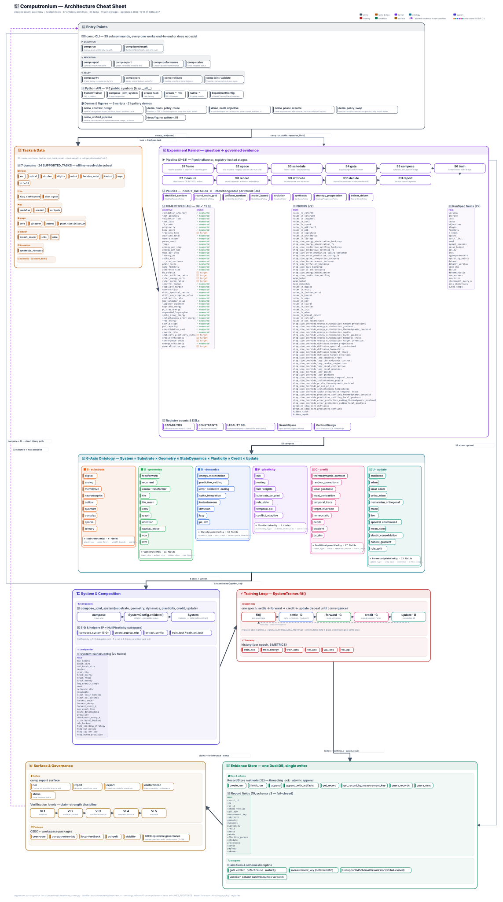

## 📋 Architecture Cheatsheet



Computronium at a glance — a live reflection of the codebase architecture, regenerated from source on every build.

### Outer Flow

```
Entry Points → Tasks & Data → Experiment Kernel → 6-Axis Ontology → System Composition → Training Loop → Evidence Store → Surface & Governance
              ↑_______________________________________________________________________________________________________|
                                    🔁 evidence → next question
```

### Panels Summary

| Panel | Key Contents |
|-------|--------------|
| **🚪 Entry Points** | `comp` CLI (10 subcommands), 142 Python API symbols, 6 demos + 21 gallery figures |
| **🎯 Tasks & Data** | 7 domains (vision, lm, rl, graph, tabular, timeseries, scientific), ~25 tasks |
| **🧪 Experiment Kernel** | 11 pipeline stages (S1–S11), 8 policies, 36 objectives (4 measured), 28 priors, 88 capabilities, 17 constraints |
| **🧬 6-Axis Ontology** | 9 substrates, 11 geometries, 8 dynamics, 7 plasticities, 10 credits, 12 updates = 57 primitives |
| **🏗️ System & Composition** | 6-axis config × SystemTrainerConfig (15 fields), `compose_joint_system` factory |
| **⚡ Training Loop** | Epoch history: train_acc, train_energy, train_loss, val_acc, val_loss + evaluator adds param_count, walltime_s |
| **💾 Evidence Store** | DuckDB, single-writer, 13 RecordStore methods, schema v3 with 21 fields, 3-tier claim status |
| **📊 Surface & Governance** | 5 verification levels (L1–L5), 5 workspace packages, `comp report/export/conformance/status` |

### Quick Reference

| Category | Count | Details |
|----------|-------|---------|
| **Substrate primitives** | 9 | digital, analog, memristive, neuromorphic, optical, quantum, complex, sparse, ternary |
| **Geometry primitives** | 11 | feedforward, recurrent, causal_transformer, tile, tile_mesh, conv, graph, attention, spatial_lattice, nca, ntm |
| **StateDynamics primitives** | 8 | energy_minimization, predictive_settling, error_predictive_coding, spike_integration, instantaneous, diffusion, lazy, pc_alm |
| **Plasticity primitives** | 7 | null, routing, fast_weights, substrate_coupled, rule_state, temporal_psi, conflict_adaptive |
| **CreditAssignment primitives** | 10 | thermodynamic_contrast, random_projections, local_goodness, local_contrastive, temporal_trace, target_inversion, homeostatic, pepita, gradient, pc_alm |
| **ParameterUpdate primitives** | 12 | euclidean, adam, local_adam, ortho_adam, riemannian_orthogonal, muon, lion, spectral_constrained, mean_norm, elastic_consolidation, natural_gradient, role_split |
| **Algorithms (composed)** | 21 | backprop, eqprop, fa, dfp, pepita, tp, predictive_coding, hebbian, snn, tilenet, tilenet_sharded, mep, mep_sharded, ... |

### Artifacts

- **SVG diagram**: [`docs/cheatsheet/cheatsheet.svg`](../cheatsheet/cheatsheet.svg) — directed architecture graph with nested panel insets
- **Data file**: [`docs/cheatsheet/cheatsheet.txt`](../cheatsheet/cheatsheet.txt) — structured data behind the diagram

> **Regeneration**: `uv run python docs/cheatsheet/cheatsheet_create.py` — pulls live facts from registries, configs, and catalogs.